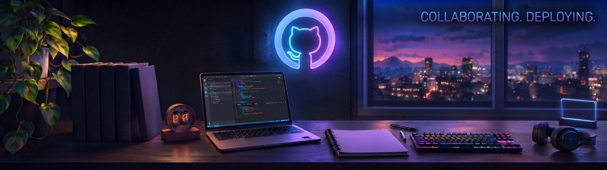

  <picture>
    <source media="(prefers-color-scheme: dark)" srcset="banner-dark.jpg">
    
  </picture>

<h1 align="center">Hedieh Razavinejad</h1>

  

---

### 👩‍💻 About me
- 🎨 I build websites and small web apps
- 🌱 Currently learning Vue 3, UI design and modern front-end
- 📚 Sharing what I learn along the way

### 📖 What I'm learning now
- Vue 3 (Options API and Composition API)
- Tailwind CSS
- Building clean, simple interfaces

### 💡 Ideas notebook
I write down my ideas here and tick them off when they become real.

- [ ] A small petty cash and invoice app with Vue 3
- [ ] A learning reference site for Vue
- [ ] Add my own idea here

### 🛠 Tools

  

### 📊 GitHub Stats

  

